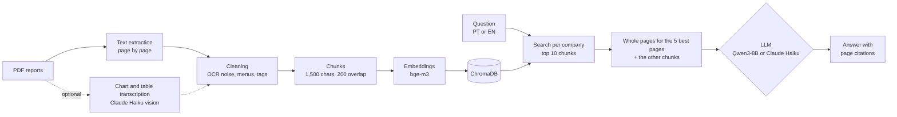

# ESG RAG: Question Answering over Corporate Sustainability Reports

A Retrieval-Augmented Generation (RAG) system that answers questions about the 2025 sustainability reports of **Vale**, **Petrobras** and **Natura**, in Portuguese or English, with **citations to the exact report page**. It compares an open-source LLM running locally (**Qwen3-8B**) with an API model (**Claude Haiku**), reads **charts and tables** from page images, and is measured by an **evaluation pipeline with 114 manually verified questions**.

| | Claude Haiku 5.5 | Qwen3-8B (local) |
|---|---|---|
| **Answer score** (106 answerable questions) | **0.915** | **0.816** |
| **"I don't know" accuracy** (8 unanswerable questions) | 1.00 | 1.00 |
| **Chart questions**, text only → with chart reading | 0.50 → **1.00** | 0.25 → **0.75** |
| Time per answer | ~2.5 s | ~13 s (T4 GPU) |
| Cost per answer | ~US$ 0.0013 | free |

---

## Why

Sustainability (ESG) reports are where companies disclose their emissions, water use, targets, social indicators and governance. They are also hard to use:

- **They are long.** The three reports in this project have roughly 90 to 240 pages each. Comparing a single indicator across companies means searching hundreds of pages.
- **The data is scattered and visual.** Many key numbers appear only in charts and infographics, which ordinary text search and text-based AI tools cannot read.
- **They don't follow one format.** Each company reports in its own structure, terminology, units and even language (the Petrobras report is in Portuguese, the Vale and Natura reports are in English).
- **Every answer needs a source.** In ESG analysis, a number without a page reference can't be trusted or audited.

This project makes that search **faster, scalable and verifiable**:

- **Faster:** a question that takes minutes or hours of manual reading is answered in seconds.
- **Scalable:** the three companies are examples. Adding a company or a year is adding a PDF named `company_year.pdf`: the pipeline indexes it, and the search covers it automatically (see [Using other reports](#using-other-reports)).
- **Comparable:** questions without a company name search **each company separately**, so cross-company comparisons ("Which companies set numeric water targets?") get evidence from all of them.
- **Verifiable:** every fact in an answer cites the company, year and page, so it can be checked in the original PDF. When the reports don't contain the answer, the system says so instead of guessing.
- **Multilingual:** questions in Portuguese or English work on reports in either language.
- **Measured:** the quality is not assumed. Every change was tested on the same set of verified questions, and the remaining errors are documented.

Possible users include ESG and investment analysts, researchers, journalists, auditors, and sustainability teams benchmarking their company against peers. The evaluation also showed a side benefit: the system surfaces **inconsistencies inside the reports themselves** (for example, a percentage change in a report's highlights that doesn't match its own financial statements).

---

## How it works



1. **Indexing** ([`01_indexing.ipynb`](01_indexing.ipynb)): extracts each page with `pymupdf4llm` (tables as Markdown), removes OCR garbage, HTML tags and navigation menus repeated on every page, splits pages into chunks at word and line boundaries, and stores `bge-m3` embeddings in ChromaDB with company, year and page metadata.
2. **Chart reading** (optional, `USE_VISION`): pages with charts, tables or large images are rendered and transcribed by Claude Haiku. The transcription is added to the page text, so it benefits **both** LLMs. Each page is transcribed only once (cached).
3. **Retrieval** ([`02_ask.ipynb`](02_ask.ipynb)): the search uses small chunks for precision, then sends the LLM the **whole page** for the 5 most relevant pages plus the other chunks found ("parent page retrieval"). Questions without a company are searched per company, so no company is crowded out.
4. **Generation:** the same prompt and sources go to both LLMs. The prompt requires using only the sources, citing every fact, keeping units, and saying when the answer isn't in the reports.
5. **Evaluation** ([`03_evals.ipynb`](03_evals.ipynb)): see below.

---

## Evaluation

The test set ([`evals/questions.csv`](evals/questions.csv)) has **114 questions**, each with a reference answer and page checked in the PDF:

- **Languages:** Portuguese and English.
- **Companies:** 32 questions about Natura, 37 about Petrobras and 30 about Vale, plus 15 **multi-company** questions that involve two or three companies at once (e.g. "Which companies set numeric water reduction targets?").
- **Categories:** numbers, qualifiers ("abroad only", "excluding The Body Shop"), targets, yes/no, multi-part, multi-company, conflicts inside a report, and 8 questions the reports can't answer.
- **Where the answer is:** `chart`, `infographic`, `table` or `text`. This column is used only for grading; the system never sees it.

For every question, retrieval and generation are graded **separately**:

| Metric | How |
|---|---|
| Retrieval hit | Code: is an expected page among the retrieved chunks? |
| Answer score | LLM-as-a-judge (Claude Haiku): `correct` = 1, `partial` = 0.5, `incorrect` = 0. The rubric separates **key facts** (numbers, units, qualifiers) from extra context. |
| Refusal accuracy | Does the system say "I don't know" on unanswerable questions? |
| Citation accuracy | Code: does the answer cite an expected page? |

### Results: chart reading (vision)

Same 114 questions, same code and retrieval settings. The only difference is whether chart and table transcriptions were added to the index.

| | Text only | Text + vision |
|---|---|---|
| **Claude** answer score | 0.863 | **0.915** |
| **Qwen** answer score | 0.764 | **0.816** |
| Retrieval hit | 0.821 | **0.887** |
| Claude citation accuracy | 0.811 | **0.868** |
| Qwen "I don't know" accuracy | 0.875 | **1.000** |

By where the answer is in the report (Claude / Qwen):

| | Text only | Text + vision |
|---|---|---|
| **chart** (8) | 0.50 / 0.25 | **1.00 / 0.75** |
| infographic (31) | 0.92 / 0.85 | 0.90 / 0.74 |
| table (24) | 0.85 / 0.69 | 0.88 / 0.81 |
| text (51) | 0.91 / 0.84 | 0.94 / 0.90 |

- **Charts are where vision clearly helps.** Without it, chart numbers reach the model as loose values without their labels. In a text-only run, Claude answered that the chart text "lists the values without a clear year-to-value mapping"; with vision, it answered correctly.
- **The gain is not noise.** Two identical runs of the same configuration gave the same average score but changed the grade of 8 of 106 questions, so small differences (~0.02) are within run-to-run noise. With vision, Claude improved on 9 questions and got worse on 2, including all 4 chart questions it had missed.
- **Vision also improves retrieval** (0.821 → 0.887): transcriptions add words such as chart titles and units to pages that used to contain mostly loose numbers.
- **Not everything improved.** Qwen's infographic score dropped (0.85 → 0.74): the longer context seems harder for the smaller model to use. Extra transcription chunks can also push the right page out of the top 10 for some questions.

### Results: retrieval strategy

Earlier experiments on a first version of the test set (107 questions, Claude, text only):

| Context sent to the LLM | Answer score |
|---|---|
| Top 10 chunks | 0.828 |
| Whole pages only (top 5) | 0.823 |
| **Whole pages (top 5) + the other chunks** | **0.904** |

Whole pages alone didn't help, because cutting the context to 5 pages dropped information the search had found. Combining whole pages with the remaining chunks kept both the depth and the breadth, improving 11 questions and worsening 1. This setup (whole pages + chunks, 10 chunks, per-company search) is the configuration used in the final system.

### What the errors show

- **Most of Claude's remaining errors are retrieval misses:** the right page was never retrieved, so the model couldn't answer. Some involve exact names, such as "Sustainability-Linked Loan", which embeddings blur into general financing topics. Others involve questions worded differently from the page: an English question about "renewable electricity" against a Portuguese page about "I-REC" certificates.
- **Qwen's errors are mostly reasoning errors with the right data.** It often reverses target comparisons (it says a company "reached" a 26% target with 23.1%), and it misreads the Portuguese thousands separator (112.744 megaliters read as 112 instead of 112,744). In one example, asked for Petrobras's 2025 emissions, Qwen gave 452 million tCO₂e, which is actually the value-chain Scope 3 (category 11) figure; Claude, with the same sources, reported the operational emissions of 50 million tCO₂e and listed the other figures separately.
- **The reports sometimes contradict themselves.** Questions in the `conflict` category check that the system reports the inconsistency instead of picking one number.

---

## Repository structure

```
├── 01_indexing.ipynb      PDFs → cleaned text → (optional) chart transcription → chunks → embeddings → ChromaDB
├── 02_ask.ipynb           Question answering with Qwen3-8B and/or Claude, with page citations
├── 03_evals.ipynb         Evaluation: 114 questions, LLM-as-a-judge, retrieval and citation metrics
├── evals/
│   ├── questions.csv      Test set with verified reference answers and pages
│   └── results_*.csv      Per-question results of each evaluation run (answers, grades, judge reasons)
├── requirements.txt
├── LICENSE                MIT
└── .gitignore             Report PDFs, databases and caches are not versioned
```

## How to run

The project was developed in **Google Colab** (free T4 GPU), with **Google Drive** as storage for the PDFs, databases, caches and evaluation results (`MyDrive/esg-rag/`). Colab and Drive are optional; [`01_indexing.ipynb`](01_indexing.ipynb) explains what to change to run it elsewhere.

1. Download the three 2025 reports (links in `01_indexing.ipynb`) and save them as `natura_2025.pdf`, `petrobras_2025.pdf` and `vale_2025.pdf` in `MyDrive/esg-rag/data/pdfs/`.
2. Add an Anthropic API key to Colab Secrets as `ANTHROPIC_API_KEY`. It is needed for Claude, the judge and the optional chart reading; Qwen alone runs without it.
3. Run `01_indexing.ipynb` (with `USE_VISION = True` for chart reading), then `02_ask.ipynb` to ask questions, and `03_evals.ipynb` to evaluate.

**Costs:** Qwen is free. Claude Haiku costs about US$ 0.001–0.002 per answer; a full evaluation run (114 questions, both models, judge) costs about US$ 0.17. Chart reading is a one-time cost, estimated at US$ 0.20–0.45 for the three reports.

## Using other reports

Vale, Petrobras and Natura are **examples**. The pipeline isn't tied to these companies, to ESG, or to Portuguese and English
(bge-m3 is multilingual):

1. **Add the PDFs** to `data/pdfs/`, named `company_year.pdf` (e.g. `ambev_2025.pdf`, `vale_2024.pdf`).
   The company and year are read from the file name and stored with every chunk.
2. **Run `01_indexing.ipynb`.** The list of companies used by the per-company search is read from the database,
   so no code changes are needed in `02_ask.ipynb` or `03_evals.ipynb`.
3. **For evaluation**, write new questions in `evals/questions.csv` with reference answers and pages checked in the new reports.
   The current questions only apply to the 2025 reports of these three companies.

The only references to the example companies outside the data are the download links in `01_indexing.ipynb`,
the example questions in the notebooks, and an optional test setting (`VISION_ONLY_PAGES`).

**From notebooks to a product:** the indexing step already works on any PDF that arrives in the folder, so the next step
for scale is to wrap it in a service: a front end where users upload reports, a backend (e.g. FastAPI) that runs extraction,
optional chart reading and embedding as a background job, and a persistent vector database instead of the copy in Drive.
Questions would go through the same API, so new reports become searchable minutes after they are uploaded.

## Limitations

- **The judge is Claude**, which may be slightly lenient with Claude's own answers. Grades were spot-checked by hand.
- **114 questions is a small test set**, so differences of about 0.02 are within run-to-run noise. Only larger differences are treated as real.
- **The image-page detector is broad:** all 237 Petrobras pages were flagged as visual (its page design has many vector shapes). Claude filters out pages without data, so this costs a little more but adds no noise to the index.
- The system covers **one year per company**. Questions about trends rely on the history each report includes.

## Next steps

- **Hybrid search** (BM25 keyword search + embeddings) to recover exact terms and codes that embeddings miss
- **Query rewriting** (e.g. adding a translation of the question in the report's language) for questions worded differently from the page
- A **reranker** to improve the order of retrieved passages
- **Prompt rules for smaller models:** explicit target comparison and number-format normalization
- More companies and years, to test how retrieval scales
- A **web interface and API** for uploading reports and asking questions, with indexing as a background job

## Tech stack

Python · pymupdf4llm · sentence-transformers (BAAI/bge-m3) · ChromaDB · Ollama (Qwen3-8B) · Anthropic API (Claude Haiku 5.5, text and vision) · pandas · Google Colab · Google Drive

## Author

**Camila Antiqueira**: Full-Stack Software Engineer and M.Sc. student in Artificial Intelligence at UTFPR.
[LinkedIn](https://br.linkedin.com/in/camila-antiqueira-073b61152/) · [GitHub](https://github.com/camilaantiqueira)

## License

The code is released under the [MIT License](LICENSE). The sustainability reports belong to their respective companies and are not included in this repository.